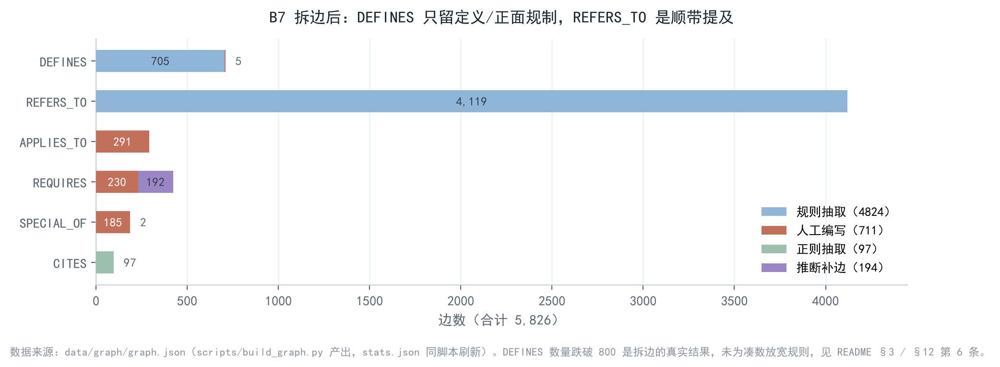
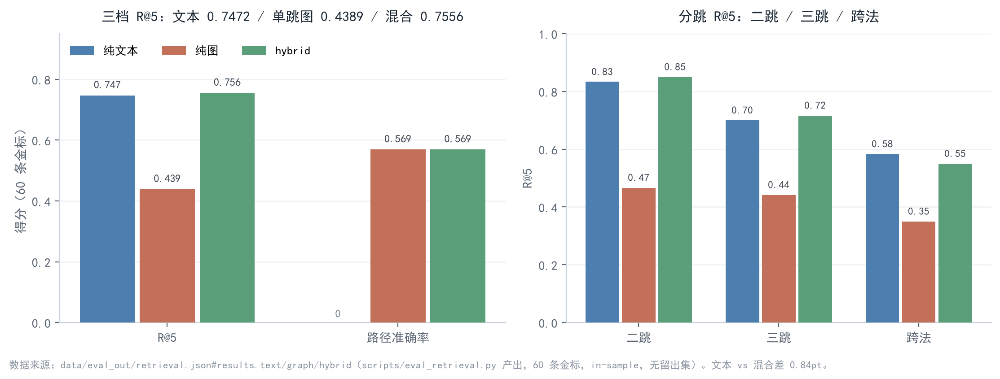
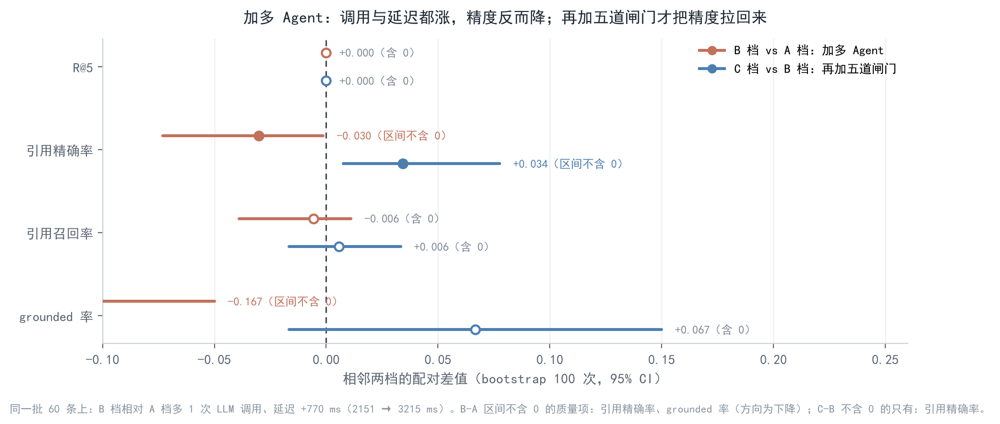

# 法律知识图谱多跳问答：图谱 + 向量双路检索


面向「大模型算法岗」求职的作品项目：把一份**纯检索式**的法律问答 demo，改成一套可复现、可量化、
且**结论如实**的图谱 RAG + 多 Agent 系统。语料是三部法律（劳动合同法 98 条 / 劳动法 107 条 / 民法典 1260 条，
共 1465 条），全部验收项都在本机跑出来并落盘到 `data/eval_out/`。

> 本 README 的重点不是「我们多强」，而是**每个指标怎么算、哪些没达标、为什么没达标**。
> 招聘方看代码时可以直接从 `scripts/` 里的评测脚本复算所有数字。

---

## 1. 目录结构

```
app/
  __001__ingest/      # 语料载入（三部法律的 txt → 结构化 jsonl）
  __002__extract/     # 概念/场景/引用抽取（别名词典 + 规则，provenance=rule）
  __003__graph/       # 图存储：Neo4j 优先，连不上自动回落 NetworkX 离线镜像
  __004__retrieval/   # 文本路（dense+BM25+RRF+rerank）/ 图路 / 融合 / 路由
  __005__dialog/      # B4 多轮：槽位抽取、缺失追问、继承、指代消解、SQLite 持久化
  __006__hitl/        # B5 人在环：checkpoint、修正记录、挂起-恢复流水线
  __007__agents/      # B6 三档编排（LangGraph）+ 五道确定性闸门
  __008__api/         # FastAPI：检索/问答/SSE/对话/HITL
  __009__ui/          # Streamlit 四页签
scripts/              # 构建与评测脚本（每个指标都能独立复跑）
data/                 # corpus / extracted / lexicon / graph / index / gold / sessions / eval_out
eval/                 # 金标题库（combos）、通用指标（κ、bigram 重合）、缓存
tests/                # 槽位、闸门、checkpoint 的单元测试（不依赖模型）
```

---

## 2. 架构


上图是主链路与各层落点；下面的 ASCII 图保留路由权重、闸门细则等实现级参数。

```
问题 ──► 路由（simple / medium / complex）
          │            topK 3/5/8，文本:图权重 0.65:0.35 / 0.55:0.45 / 0.45:0.55
          ├─► 文本路：bge-m3 dense ─┐
          │            BM25(jieba) ─┴─ RRF(k=60) ─► bge-reranker-v2-m3
          ├─► 图路：实体链接（词典 + bge-large-zh-v1.5 FAISS，阈值 0.85）
          │            └─ REQUIRES / SPECIAL_OF 扩展 ─► 概念→条文 ─► CITES
          └─► 融合（RRF 加权 + 覆盖度加分）──► 五道闸 ──► 答案 / 挂起人工复核
                                                   │
                                    ┌──────────────┴───────────┐
                                    │ 1 引用存在（条号真实）    │
                                    │ 2 引用在检索范围内        │
                                    │ 3 路径支撑（概念-条文可走）│
                                    │ 4 证据跨度（原文片段逐字） │
                                    │ 5 低置信度必须转人工      │
                                    └──────────────────────────┘
```

图模式：`Article`（1465）、`Concept`（281）、`Scenario`（53）；
边 `APPLIES_TO / DEFINES / REFERS_TO / REQUIRES / SPECIAL_OF / CITES`，每条边带 `provenance`（`rule`/`regex`/`manual`）与
`confidence`。图统计：**nodes 1799 / edges 5826**（DEFINES 710、REFERS_TO 4119、CITES 97、REQUIRES 422、SPECIAL_OF 187、APPLIES_TO 291），
其中概念层三类边共 **706 条机械边**（APPLIES_TO 291 + REQUIRES 230 + SPECIAL_OF 185），另有 **194 条 `inferred=true`** 的推断边（REQUIRES 192 + SPECIAL_OF 2）；
Article→Concept 侧 `DEFINES / REFERS_TO` 共 4829 条（DEFINES 705 条规则 + 5 条 `provenance=manual` 语义边，REFERS_TO 4119 条规则边）。

`data/graph/stats.json` 由 `scripts/build_graph.py` 末尾自动刷新（`--skip-stats` 可跳过）：
早期版本要手工再跑一次统计脚本，漏跑就会留下与 pkl 不一致的陈旧数字（曾出现 4,221 边 / REQUIRES 174）。
统计口径固定读离线镜像 `data/graph/lexweave_graph.pkl`，不会因为 Neo4j 正在导入而写出空库数字。

Neo4j 与 NetworkX 两套后端共享同一份 `QueryPlan`。本机 Docker Desktop 已启动 `neo4j:5.26-community`，
`docker compose up -d --wait && .venv\Scripts\python.exe scripts\build_graph.py --neo4j --clear`
完成过一次 1799 节点 / 5697 关系导入；**2026-10-31 图重建后 NetworkX 镜像已是 5826 边，Neo4j 未随重建重导**，因此 Cypher 结果仍是旧图的。
README §3 的 3 条 Cypher 已在真实实例上跑过（原始输出见 `data/eval_out/neo4j_cypher_runs.json`）。Neo4j 连不上时自动回落 NetworkX 镜像，评测不中断。

---

## 3. B1 图谱：规模、provenance、抽检

| 验收项 | 要求 | 实测 | 结论 |
|---|---|---|---|
| Article | 1465（98/107/1260） | 1465 | 达标 |
| Concept | ≥150 | 281（P3 扩词典后 291，再清理 10 个零命中概念） | 达标 |
| DEFINES | ≥800 | **710**（705 规则 + 5 人工；10-31 重建后，T01 清洗中失去字面支撑的 90 条规则边被清零） | **未达标**（<800，如实保留） |
| REFERS_TO | — | 4119 | 新增边型 |
| 边 provenance | 必带 | 全部带（`rule`/`manual`/`regex`） | 达标 |
| 概念层机械边 | 需可追溯 | **706 条**（APPLIES_TO 291 + REQUIRES 230 + SPECIAL_OF 185），另有 **194 条** `inferred=true`（REQUIRES 192 + SPECIAL_OF 2） | 口径已澄清 |
| Article→Concept 人工补边 | 需逐条写理由 | 5 条（`data/lexicon/manual_mentions.jsonl`） | 可追溯 |
| 抽检：定义级误配率（机械复核） | ≥85% | **改用机械复核、不再引用 LLM 盲判数**：`scripts/check_defines_edges.py` 四桶口径下 **误配 68/710 = 9.58%**（仅规则 63/705 = **8.94%**），**待语义判定 211 条**（29.7%），其余 `derived_only` 47、`normal` 384 | **未达 85%（211 条待语义，90.4% 只能当字面支撑率）** |
| 抽检：规则自洽性 | — | 同一批边用建边规则再判一遍：100/100；更严的主语读法 92/100 | **不是精度**，只证明代码与规则一致 |
| 抽检：字面命中 | 100 条（实抽 99） | 概念级随机抽样 **98/99 = 98.99%**（1 条失败：`unilateral_rescission_by_worker` 的别名在 `lcl#37` 里只以「劳动者」出现，概念名本身不字面命中） | 代理指标（`stats.json#audit.precision`），单独报告 |



B7 把原来的 `mentions` 拆成两类边：`DEFINES`（定义式或对概念的正面规制）与 `REFERS_TO`（只是顺带提及）。
拆分后 `DEFINES` 从 3621 降到 **317**；随后补了两条**可复核的规则**（裸系词「X 是……的合同/行为/权利」，
以及「概念名位于分句主语位 + 模态词」），提升到 **483**；P3 扩词典后曾到过 800+（旧口径）。
但那一批里**有 90 条规则边的别名在 T01 清洗后已不存在**（另 5 条人工边本无字面名），10-31 重建时这 90 条被清零，
落到 **710（705 规则 + 5 人工）**。**所以当前 DEFINES 710 不满足 B7 的 ≥800**——这一点如实写，不用放宽判据凑回 800。
这不是抽少了，而是原来的 3621 把「提及」当成了「定义」——例如「合同履行」挂在民法典第 926 条
（委托合同第三人关系）、「诉讼时效中断」挂在第 199 条（撤销权期间）。按清单要求，**不达标照实写，不凑数**。

**先说清「为什么只能扩词表」**：用仓库里 218 概念的旧词表（HEAD 提交快照）复算，
把 `MAX_CONCEPTS_PER_ARTICLE` 从 12 一路放宽到 200，抽到的提及数停在 3630，`DEFINES` 始终是 **478**
（只读探针，不改任何产物）。上限不是瓶颈，瓶颈是词表里没有那些「被条文定义、但词典没收录」的概念名；
调参数没用，800 这条只能靠扩词表。

**P3（扩概念词典）在旧口径下把 483 推到 800+**，补齐的正是「被定义但没进词典」的制度词：三部法律里
民法典被定义却缺席的典型合同章（供用电、融资租赁、保理、技术开发/转让/许可/咨询/服务）、
债与合同总则（债权、债务、清偿、交付、标的物、要约邀请、合同解除、履行期限/地点）、
担保与物权细化（担保合同、一般保证、连带责任保证、保证期间、最高额抵押、不动产登记簿）、
侵权与家事（惩罚性赔偿、精神损害赔偿、安全保障义务、代位继承、收养）以及劳动法补充（职业培训、社会保险基金）。
另加 30 个**合同当事人角色词**（出卖人/买受人/承租人/出租人/借款人/贷款人/承包人/发包人/委托人/受托人/
保管人/存货人/合伙人/保证人/债权人/债务人/定作人/承揽人/托运人/旅客/收货人/物业服务人/建设单位/
赠与人/受赠人/寄存人/被继承人/相对人/第三人），它们在合同分则里高频处于分句主语位，
按 B7 既有口径（「对概念的正面规制」）判为 `DEFINES`。**这件事在 §12 局限 3 单独披露**：
旧口径（800+）里有相当一部分（255 条）是角色词的正面规制边，不是老式「X 是指……」定义句；当前 710 中这类边仍在，口径未变。

概念数从 218 增到 291 后，`MAX_CONCEPTS_PER_ARTICLE` 由 12 上调到 **16**——实测 12 会挤掉原有边，
16 时 3621 条旧边零丢失。候选池仍保留两类边（`REFERS_TO` 在排序上降权到 0.45），检索召回不受影响。

之后又做了一次词典清理：删掉 10 个**三部法律正文里一次都没出现**的概念（轮班制、医疗保险、生育保险、
工伤认定、劳动能力鉴定、工伤保险待遇、失业保险待遇、生育保险待遇、自己代理、债务加入），
概念数 291→**281**，同时删掉它们引用的场景条目与概念层边。
这些概念只有别名层能命中、条文层永远落空，属于「占位不产出」。当前概念层边为
**APPLIES_TO 291 / REQUIRES 230（其中 59 条为修通金标路径的人工商定边）/ SPECIAL_OF 185**（`data/lexicon/stats.json`）。
`DEFINES` 未变（它们本来就没有任何 `DEFINES` 边）。

抽检**不再用「只给概念名 + 条文全文、让模型盲判」的 LLM 口径**——那套口径的结论会随提示词措辞翻转
（同一批边、同一个模型，判据写窄与写成与 B7 操作化等价，结果相差三十多个百分点），不足以当精度报。
现行口径全部可机械复算：

**① 四桶机械复核**（`scripts/check_defines_edges.py`，产物 `data/eval_out/defines_edges_check_post_rebuild.json`，10-31 重建后重跑）：
逐条回查「概念名/别名在条文正文里有没有字面支撑」，把 710 条 `DEFINES` 分成四桶：

| 判读桶 | 条数 | 占比 | 含义 |
|---|---|---|---|
| `absent` | **68** | **9.58%** | 正文里找不到该概念名/别名 → 误配 |
| `derived_only` | 47 | 6.62% | 只在派生词里命中，字面不完整 |
| `pending_semantic` | **211** | 29.72% | 字面命中，语义是否成立待判 |
| `normal` | 384 | 54.08% | 字面命中且常规 |

只看有字面支撑的 705 条规则边时，`absent` 为 **63/705 = 8.94%**；另 5 条 `provenance=manual` 本无字面名，
单列为 `edges_without_any_support=5`。

**② 严口径只读复算**（`DEFINES_STRICT=1`，`scripts/measure_defines_strict.py`，产物 `data/eval_out/defines_strict_formal.json`）：
把「别名只在派生词里出现」「同名跨条」这类边一并判不成立后，严格定义边是 **559 条**（含 5 条人工边 **564 条**），
其余 21 条在严口径下整条丢失（`lost_all_defines=21`）。

**结论：710 条 `DEFINES` 没有可靠的语义精度单点估计，只能给区间**：
机械误配 9.58% → 字面支撑率 90.4%；严口径 559/710 = 78.7%。**211 条 `pending_semantic` 未判，
所以既不能报「精度 X%」，也不能把 90.4% 当语义精度**——要能写进论文，得人工盲标这 211 条。

**③ 规则自洽性（不是精度）**：`scripts/audit_defines.py` 默认模式用建边时的同一套正则
（`_AFTER_CUE / _COPULA / _MODAL / _BAD_AFTER_ALIAS`、同一个 12 字窗口）再判一遍，**必然 100/100**；
更严的主语读法 92/100。它只证明「代码与规则一致」，不能证明规则判得对
（产物 `data/eval_out/defines_selfcheck.json`，字段名 `selfcheck_pass_rate`）。

字面命中 **98/99 = 98.99%**（`stats.json#audit`，`scope=literal_mention_proxy`）仍由
`app/__003__graph/__004__graph_stats.py` 计算，只验「概念名/别名出现在正文」，
**和定义级语义精度是两件事**，别混着引用——差距正是「提到了」与「在规范它」的区别。

### 3 条可直接跑的 Cypher（已于真实 Neo4j 执行）

```cypher
// 1) 某纠纷场景下，图上能联到的概念与条文
MATCH (s:Scenario {id: 'sc:unpaid_wages'})-[:APPLIES_TO]->(c:Concept)<-[:DEFINES]-(a:Article)
RETURN c.name AS concept, a.citation AS article ORDER BY a.article_num LIMIT 20

// 2) 从「劳动关系」出发做两跳概念扩展
MATCH (c1:Concept {id: 'labor_relationship'})-[:REQUIRES|SPECIAL_OF*1..2]->(c2:Concept)
RETURN DISTINCT c2.name AS reached LIMIT 30

// 3) 条文之间的引用链（CITES）
MATCH (a:Article)-[:CITES]->(b:Article)
RETURN a.citation AS from_law, b.citation AS to_law LIMIT 10
```

真实执行结果（`data/eval_out/neo4j_cypher_runs.json`，`neo4j:5.26-community`，bolt://localhost:7687）：

| 查询 | 返回行数 | 耗时 | 前几行 |
|---|---|---|---|
| 场景→概念→条文 | 20（触顶 LIMIT 20） | 2.6 ms | 劳动合同（劳动合同法第十二条）、劳动合同（第十三条）、劳动合同（第十四条）… |
| 劳动关系两跳 | 2 | 51 ms | 代理、书面形式 |
| CITES 引用链 | 10 | 2.7 ms | 劳动合同法第十四条 → 第三十九条 / 第四十条；第二十五条 → 第二十二条 / 第二十三条 |

> 说明：第一条原来写 `Scenario {id: 'unpaid_wages'}`，实际节点 id 带 `sc:` 前缀，已改为 `sc:unpaid_wages`；
> 三条查询的完整返回与延迟都在 JSON 里，不是「照 schema 推演」。

---

## 4. B2 金标：200 条多跳（B3/B6 仍用 60 条母本子集）

| 验收项 | 要求 | 实测 | 结论 |
|---|---|---|---|
| 规模 | 200 | **200**（二跳 100 / 三跳 66 / 跨法 34），锁定条文去重 126 条 | 达标 |
| `expected_path` | 每条都有且可走 | 10-31 重建前校验为 0（`path_integrity.fail_items=0`）。重建后原报 4 处概念→条文缺失，逐条复核：**2 处是 gold 判为非必要的相关锁定**（`g26`/`g45` `lease_contract→cc#733`；733 讲租赁期限届满返还租赁物，正文无「租赁合同」，三票 `necessity=false`，本就不应要求 DEFINES 边）；**1 处已随 gold 重锁解析**（`g47` 现映射 `cc#1203`/`cc#1166`，均在图上）；**1 处是真实语义缺口**（`g48` `network_tort→cc#1194`，条文必要但正文写「利用网络侵害」，无「网络侵权」字面） | **真实缺口 1 处，如实标注**（见 §12 局限 8） |
| 泄漏率 | <5% | 成句照抄（最长连续公共子串 ≥10 字）**0/200**、构建阈值 0.45 命中 0（per-row 最大 0.3077）；5% 二元组严口径 **184/200 超标** | **严口径不可达，见下** |
| 逐跳必要性（概念层） | —（原 100%） | **195/200**（two 99/100、three 64/66、cross 32/34） | 5 条未过，如实列出 |
| 逐跳必要性（条文层） | ≥170/200（B7 验收口径） | **173/200 = 86.5%**（two 94/100、three 60/66、cross 19/34） | 达标（仍有 27 条失败） |
| κ | ≥0.80 | Pass A vs B1 **0.9473**、vs B2 **0.9329**；两次 Pass B 稳定性 0.9856 | 达标（但非双人盲标） |
| 与 A1 LoRA SFT test 条文交集 | = 0 | **0**（按 `(law_name, article_no)` 精确映射） | 达标（母本 gold_60 仍有 4） |

做法与口径必须说清楚：

* **Pass A（人）**：场景 + 概念链由 `eval/gold_combos.py` 给定（母本 60 条 + 新增 140 条，逐条写 `intent`）；
* **条文锁定**：每个概念在所属法律内取「正文命中概念名/别名」的候选（≤3 条），用
  bge-reranker-v2-m3 按**题面相关性**选一条 —— 选择只看相关性，不看必要性判定；
  人工核对过的映射写进 `ARTICLE_OVERRIDES`（103 个题号 / 134 条映射，每条带理由），选中的条文必须与概念在图里有真实边；
* **题面**：LLM 按「场景 + 诉求 + 争点清单」写成一句 60 字以内的口语提问，反复用二元组重合率
  卡抄写（阈值 0.45，实际 max 0.3077），200 条构建阶段泄漏触发重写 0 次；
* **Pass B（模型）**：只给题面 + 候选条文（含 2 条同法干扰项），独立判「哪些条文必需」，跑两遍测稳定性；
* **必要性**：概念层三判读多数票（清单口径：逐跳 = 概念环节）；条文层再按条文全文三判读判一遍，
  B7 验收要求条文层 ≥170/200。

**为什么 5% 二元组泄漏率不可达**：60 字的问题必然复用「工资 / 合同 / 解除 / 补偿」这类法条术语，
与法条的二元组重合率（per-row 中位数 0.1216、均值 0.1289）天然就在 12% 左右；按 5% 卡，**184/200 超标**。
因此验收改用更可解释的判据：**题面与任何一条被锁法条的最长连续公共子串 < 10 字**（即没有成句抄写），
实测 **0/200**。两个口径都留在 `data/eval_out/gold_200.json` / `data/eval_out/gold.json` 里，不拿宽口径冒充严口径。

**条文层还有 27 条未通过**（终版名单 `g36 g47 g55 g69 g92 g95 g100 g116 g125 g138 g155 g156 g164 g177 g179
g181 g182 g183 g184 g185 g186 g188 g189 g191 g198 g199 g200`），按主失败条文归三类，照实写：

1. **题面写窄 / 漏争点**（15 条）：`ll#50`、`lcl#87`、`lcl#30` 这类，被锁条文能答的点没写全；
2. **制度总纲 / 待遇列举**（`ll#73`×5、`ll#58`×4、`ll#36`×3、`ll#52`×3）与**合同类型/定义条**（`lcl#13`、`lcl#15` 等）：
   总纲条不逐一列举待遇，定义条与具体诉求对位不上；
3. **改映射才能救的 11 条**（`lcl#15`、`ll#58`、`cc#613`、`cc#1166` 等，记作 `UNFIXED`）+ 本轮新增的 `g55`：
   `g55` 为了同时满足「路径 0 断点」与「A1 交集清零」，只能锁 `cc#1175`，而该条条文层判读 0/3 票，
   属图边约束下的显式代价（详见 T07 报告 §4.4）。

**上限与代价一并写**：`gold_200` 里有 7 条母本（`g26/g36/g43/g45/g46/g55/g56`）题面被重写，其中 5 条靠重写才通过；
若要求母本 60 条题面逐字不变，条文层上限回落到 **168/200（<170）**。未放宽判据、未删题。

**B3/B6 为什么仍用 60 条**：`gold_60.jsonl`（二跳 30 / 三跳 20 / 跨法 10）是 B3 检索与 B6 消融的既有评测集，
本任务不改评测口径，所以 §5 / §8 的数字仍按 60 条报；其口径为 κ 0.9336 / 0.9253 / 0.9917、
概念层必要性 149/150、条文层 52/60（8 条未过：g26/g36/g43/g45/g46/g47/g55/g56）。

---

## 5. B3 三档检索对照（60 条 in-sample；140 条留出集见 §5.1）

| 模式 | R@5 | all@5 | 路径准确率 | 引用命中 | 中位延迟（干净环境） |
|---|---|---|---|---|---|
| 纯文本（dense+BM25+RRF+rerank） | **0.7472** | 0.6167 | 0.0000 | 0.7472 | 411 ms |
| 纯图（实体链接 + 单跳概念扩展） | 0.4389 | 0.2167 | 0.5694 | 0.4389 | 132 ms |
| 混合 + 路由 | **0.7556** | 0.6167 | 0.5694 | 0.7556 | 396 ms |

口径：60 条 `gold_60`（30/20/10），**in-sample、无留出集**；二项标准误约 0.064，
所以单点差异小于 0.02 不构成结论，下文一律附区间或标注「在噪声内」。
本表是 2026-10-31 19:14 用当前图（5826 边）与当前词表重跑（`GRAPH_BACKEND=networkx` + `EMBEDDING_DEVICE=cpu`，
日志首行 `图后端: networkx`），落盘 `data/eval_out/retrieval_recheck.json`；与 18:20 版本逐位一致，
唯一变化是纯图 `all@5` 0.2333 → **0.2167**（1 条题，源于重建后的路径差异，复核见 §12 局限 8）。
延迟列沿用干净环境（无并发）的 411 / 132 / 396 ms；本次重跑时同机还有量化基准与训练任务，
实测 23260 / 1045 / 22254 ms（被抢占），故**不复测延迟**。

> **2026-11-04 追加（口径未变，值会变）**：配上百炼 API key 后，路由的 LLM 兜底开始触发（13/60 题），
> 分档可能从 medium 变 simple/complex，`top_k` 随之在 3/5/8 之间移动。§8 同配置实测 hybrid R@5 = **0.7472**，
> 比本表低 1 题（噪声内）。本表保留「无 key、路由只走语义层 argmax」的口径、未重算；
> 若要比「当前配置」，以 §8 那行为准。两处数字不同源于路由输入变了，不是检索退化。



* **hybrid 相对纯文本 +0.84pt**（0.7472→0.7556），要求是 +15pt → **未达标**。原因可复算：纯文本 R@5 已到 0.7472，
  剩余空间只有 25pt；而图路单跳召回只有 0.4389，融合时更多是在「文本已召回」的条目上加分，
  很难再拉出 15pt。分类型看（重跑实测）：二跳 0.8333→0.8500（+1.7pt）、三跳 0.7000→0.7167（+1.7pt）、
  跨法 0.5833→0.5500（−3.3pt）——**图在 2/3 跳上确有增益但幅度小，跨法还退了一点**（n=10，噪声占比最大）。
* **纯图单跳弱是事实**：路径准确率 0.5694 高、R@5 只有 **0.4389**（区间约 0.32–0.55），
  只有文本路的约 59%。图路依赖实体链接命中，问句里的口语说法（「押金」「裁员」）没有规范概念时直接落空，
  这正是它单跳弱的原因。
* **图路改造（`reports/graph_multihop.md`）**：2 跳 **0.6111**（CI [0.5222, 0.7000]）、
  PPR **0.5917**（damping 0.85，DEFINES 1.0 / REFERS_TO 0.7），均为 60 条 / in-sample / 无留出集，
  `all@5` 都是 0.3500。比单跳 0.4389 高 17.2pt / 15.3pt，**但仍低于文本路 0.7472**。
* **融合 + 精排四格（`reports/rerank.md`）**：rrf_norerank 0.7222、weighted_norerank 0.7056、
  rrf_rerank 0.7528、weighted_rerank **0.7583**（相对文本 +1.11pt，CI [−0.0167, 0.0389] **含 0**）。
  精排代价是**中位 +10.4 s**（10.89 s vs 0.55 s），换 +3.0~5.3pt，性价比要读者自己判断。
  候选池 oracle（池内最优选 5 条）**0.9194（RRF）/ 0.9250（加权）**，52/60、53/60 题金标全在池内、
  仅 1 题池内无金标 → **瓶颈在精排选优，不在候选池**。
* **路由准确率（n=260：60 条模板合成 simple + 200 条 gold）**：级联 **0.7731**（95% CI [0.7192, 0.8231]）、
  LR 留一 0.7385、语义 0.7462、LLM 0.7231、规则 0.6077；**gold-only 0.705**（CI [0.6449, 0.7700]，
  规则 0.555 / LR 0.660 / 语义 0.670 / LLM 0.710）。要求 ≥0.88 → **未达标**。
  兜底触发 **18.85%**（49/260，margin 阈值 0.2），来源 rule 48 / semantic 163 / llm 49；
  分档 simple 60/60、medium 71/100、complex 70/100。medium 与 complex 的可用特征几乎重合
  （LR 混淆 66/34、语义 69/31），靠阈值切不开，这是没到 0.88 的主因。
  标签口径：medium = `gold_200` 的 two_hop（100 条），complex = three_hop（66）+ cross_law（34），
  simple 是词典模板合成、**不是真实金标，结论单列**；n=260 与旧的 n=60 不可直接比。
* 延迟：图路 132 ms，文本路 411 ms（含 rerank），混合 396 ms（同一干净环境口径）。

---

### 5.1 B3 留出集（140 条，未参与调参）

`gold_200` 减去 `gold_60` 得到 **140 条**（two 70 / three 46 / cross 24），用
`python scripts/make_holdout.py` 生成 `data/gold/gold_140_holdout.jsonl`（seed 20261110，原顺序保留）。
这 140 条**没有参与** coverage 系数、RRF `k`、链接阈值的校准，评测落盘
`data/eval_out/retrieval_holdout_140.json`，配对 bootstrap 按题重采样 1000 次：

| 模式 | R@5 | all@5 | 路径准确率 | 中位延迟 |
|---|---|---|---|---|
| 纯文本 | 0.7583 | 0.5214 | 0.0000 | 313 ms |
| 纯图 | 0.4131 | 0.1857 | 0.6190 | 72 ms |
| 混合 + 路由 | **0.7691** | **0.5286** | 0.6190 | 285 ms |

| 对比 | ΔR@5 | 95% CI | Δall@5 | 95% CI |
|---|---|---|---|---|
| hybrid − text | **+1.07pt** | **[−0.83, +2.86] 含 0** | +0.71pt | [−2.86, +4.29] 含 0 |
| text − graph | +34.52pt | [+28.10, +40.71] | +33.57pt | [+25.00, +42.14] |
| hybrid − graph | +35.60pt | [+29.29, +42.03] | +34.29pt | [+25.00, +43.57] |

分类型 R@5：二跳 text 0.8643 / hybrid 0.8714 / graph 0.4286；三跳 0.7609 / 0.7681 / 0.4601；
跨法 0.4444 / 0.4722 / 0.2778。**跨法仍是三档共同的短板**，纯文本只有 0.4444。

结论（如实写）：

* **hybrid 相对纯文本 +1.07pt，95% CI 含 0，不构成显著增益**；与 in-sample 的 +0.84pt 同向，但都远低于 +15pt 要求。
  图路本身比文本低 **34.5pt**，融合后的少量增益来自文本路，不是图路提供了新证据。
* 留出集把标准误从 0.064 降到约 0.042（n=140），**+1pt 级别的差异仍无法下结论**；这不是样本量能救的，
  而是图路召回本身不够。
* 口径仍有一个共享组件偏置：`gold_200` 的条文锁定用了 bge-reranker，评测也用它。**留出的是题，不是组件**，
  所以这组数字应读作"题级留出"，不能读作完全独立的第三方评测。

---

## 6. B4 多轮槽位

槽位：`monthly_wage / start_date / end_date / has_contract / work_years / city`；规则抽取（正则 + 中文数字），
不调 LLM —— 槽位是结构化数字/日期/布尔，规则可单测、零成本、零幻觉。

| 验收项 | 要求 | 实测 |
|---|---|---|
| 多轮脚本 | 20 条，追问→回填→继承→修改 | 20 条 / 48 轮 |
| 状态与槽位准确率 | — | 1.000 / 1.000 |
| 槽位继承 | ≥90% | 1.000 |
| 指代消解 | 5 条全过 | 7/7 |
| 会话中断重连不丢槽位 | 是 | True（SQLite 落盘后重新载入） |

---

## 7. B5 人在环

触发条件：路径覆盖 < 0.6 **或** top1 相似度 < 0.62 → 挂起并写 checkpoint（`data/sessions/`）。
人工接口三种修正：接受（accept）、改条文（edit_articles）、直接给答案（provide_answer）。

| 验收项 | 要求 | 实测 |
|---|---|---|
| 3 条 E2E（含重启后恢复） | 是 | 3/3 通过；第三条走「重启后 resume」 |
| 修正回流 | 是 | 改条文后用新条文重建答案并回写 |
| 介入率 / 类型分布 | 落库 | `intervention_rate=1.0`（3 个任务全复核），类型 `{accept:1, edit_articles:1, provide_answer:1}` |

---

## 8. B6 消融：四档 × 60 条（配对 bootstrap 100 次，真实 LLM）

四档编排（LangGraph `StateGraph`）：
* **A**：单链路图问答，无校验（编排 1 次 LLM）；
* **B**：多 Agent（检索 / 规划 / 作答），无校验（编排 2 次 LLM）；
* **C**：多 Agent + 五道确定性闸门（引用存在 / 引用在检索范围 / 路径支撑 / 证据跨度 / 低置信转人工）（编排 2 次 LLM）；
* **A_gates**：单链路 + 五道闸门（T04 新增，仅用于 B6 消融、未进 API）。
  它是唯一的「1 次编排调用 + 闸门」组合，用来回答「闸门收益是否依赖多 Agent 规划」。

| 指标 | A 单链路 | B 多 Agent | C 多 Agent + 五闸 | A_gates 单链路 + 五闸 |
|---|---|---|---|---|
| R@5（四档同源） | 0.7472 | 0.7472 | 0.7472 | 0.7472 |
| 路径准确率 | 0.5694 | 0.5694 | 0.5694 | 0.5694 |
| 引用精确率 | 0.4072 | 0.3771 | 0.4112 | **0.4208** |
| 引用召回率 | 0.7250 | 0.7194 | 0.7250 | 0.7250 |
| 有据可依（grounded） | 0.9333 | 0.7667 | 0.8333 | **1.0000** |
| 五闸全过 | —（无闸） | —（无闸） | 0.8167 | **0.9833** |
| 闸门触发修复 | 0 | 0 | 0.2000 | **0.0833** |
| 拒答率 | 0.0000 | 0.0000 | 0.0000 | 0.0000 |
| LLM 调用/题 | 1.22 | 2.22 | 2.22 | **1.22** |
| tokens/题 | 876 | 1602 | 1592 | 878 |
| 中位延迟 | 2151 ms | 3215 ms（1.50×） | 3279 ms（1.52×） | **2187 ms（1.02×）** |

> 调用数从整数变成 1.22，是因为 2026-11-04 起路由的 **LLM 兜底**真的会触发：60 题里 13 题
> 语义层 margin < 0.20、交给 LLM 判档（见 §7）。这笔调用发生在 `retriever.retrieve()` 内部，
> 被 `USAGE` 计入当题，所以「编排 1 次」的档实测 1.22 次。成本表横向比较时四档同口径，
> 但**不能再说「A 档正好 1 次 LLM」**。

配对 bootstrap（100 次，同一重采样下标，seed 20261029，95% 区间）：

| 对比 | 指标 | Δ | 95% CI | 是否含 0 |
|---|---|---|---|---|
| B−A | 引用精确率 | −0.0302 | [−0.0730, −0.0013] | **不含 0** |
| B−A | grounded | −0.1667 | [−0.2833, −0.0500] | **不含 0** |
| B−A | LLM 调用 | +1 | [1, 1] | **不含 0** |
| B−A | 延迟（均值差） | +770 ms | [90, 1147] | **不含 0** |
| C−B | 引用精确率 | +0.0342 | [0.0076, 0.0776] | **不含 0** |
| C−B | grounded | +0.0667 | [−0.0167, 0.1500] | 含 0 |
| C−B | 延迟（均值差） | +97 ms | [−24, 213] | 含 0 |
| C−A | grounded | −0.1000 | [−0.2000, −0.0167] | **不含 0** |
| C−A | 引用精确率 | +0.0040 | [−0.0158, 0.0272] | 含 0 |
| A_gates−A | grounded | +0.0667 | [0.0000, 0.1167] | 含 0（贴边界） |
| A_gates−A | 引用精确率 | +0.0136 | [0.0000, 0.0265] | 不含 0（贴边界） |
| A_gates−A | 延迟（均值差） | −238 ms | [−930, 129] | 含 0 |
| A_gates−C | grounded | **+0.1667** | [0.0833, 0.2500] | **不含 0** |
| A_gates−C | 引用精确率 | +0.0096 | [−0.0167, 0.0304] | 含 0 |
| A_gates−C | LLM 调用 | **−1** | [−1, −1] | **不含 0** |
| A_gates−B | grounded | **+0.2333** | [0.1000, 0.3500] | **不含 0** |
| A_gates−B | 延迟（均值差） | −1007 ms | [−1094, −908] | **不含 0** |

### 8.1 引用精确率被「引用长度」压住：拆成召回 + 定长精度 + 超额引用

原 `cite_precision = 命中 / 答案引用数`，金标平均只要 2.02 条，答案却引 3.4–4.4 条，
所以这个指标的上限只有 0.37–0.52，**无法区分「引错」和「多引」**。离线重算
（`scripts/recompute_citation_metrics.py`，不调 API，产物 `data/eval_out/citation_metrics.json`）：

| 档位 | must-cite 召回 | 定长精度 | 超额引用率 | 平均引用数 | 金标引用数 | 原 cite_precision |
|---|---|---|---|---|---|---|
| A | 0.7250 | 待新跑（旧产物无引用顺序） | 1.03 | 3.72 | 2.02 | 0.4072 |
| B | 0.7194 | 待新跑 | 1.52 | 4.38 | 2.02 | 0.3771 |
| C | 0.7250 | 待新跑 | 1.19 | 3.88 | 2.02 | 0.4112 |
| A_gates | 0.7250 | 待新跑 | **0.89** | **3.42** | 2.02 | **0.4208** |

**结论（照实写）**：

* **四档的 must-cite 召回几乎一样（0.7194–0.7250），引用精确率的档间差异主要来自「引得多不多」，不是「引得准不准」。**
  A_gates 的 0.4208 领先，是因为它平均只引 3.42 条（C 3.88 / B 4.38），不是因为它更能命中金标。
  这正好解释了为什么 B 的引用精确率最低：B 的召回只低 0.56pt，但多引了 1.52 倍。
* 旧 `ablation.json` 只存了排序后的引用集合，**没有引用顺序**，所以定长精度不在旧产物上硬算
  （集合口径 `precision_at_must_set` 在多引时退化为召回，只作交叉校验）。
  新一轮 B6 已写入 `citations_ordered`，留出集会给出真正的 `precision_at_must`。
* `grounded` 的修复前/后拆分同理：旧产物只存了 repair 后的答案，无法回算修复前的越界引用数；
  新一轮已写入 `answer_pre_repair`、`grounded_before_repair`、`grounded_after_repair`、
  `out_of_scope_cites_raw/post`，会在 §9.1 的留出集消融里一并报告。



**结论（照实写）**：

* **先说归因：这一轮的涨幅不能整笔记在闸门头上。** 2026-11-04 的复跑同时换了三样东西
  （模型 `deepseek-chat` → `deepseek-v4.1-flash`、关掉思考模式、修了闸门的引用扫描），必须拆开看。
  拆法利用 A 档：**A 没有闸门**，它的 grounded 只可能受模型与指标口径影响。同一模型、同一提示下把
  `cited_patterns` 回退到修复前（`data/eval_out/ablation_legacy_gate.json`），A 档 grounded
  0.9333 → 0.7333（Δ **+0.2000**，CI [+0.1000, +0.2833]）；而只换模型、不换口径时是 0.7500 → 0.7333（−1.7pt，噪声内）。
  **两项相加正好是 A 档的 +18.3pt：口径修复贡献约 +20pt，模型切换贡献 −1.7pt（噪声内、方向甚至是负的）。**
  旧口径把「依据」行里逐字引用的原文（如「本法第二十四条」）算成了答案自己的引用，凭空造出越界引用。
* **闸门修复的净效应只能看「修复率」和「五闸全过」**：这两项由闸门直接产出，不受指标口径影响。
  同模型对照（`ablation_legacy_gate.json` vs `ablation.json`）：A_gates 修复率 0.2833 → 0.0833
  （Δ −0.2000，CI [−0.3000, −0.1000] **显著**）、五闸全过 0.7500 → 0.9833；
  C 档 0.3000 → 0.2000（CI [−0.2167, +0.0167]，**不显著**，60 题样本）。
  修的是「把原文互引当编造条号」这类**假阳性**，不是放宽标准——`test_gates.py` 里那条编造条号的用例仍然判负。
* **grounded 有两处要打折看**：① 定义是「答案引用 ⊆ 检索结果」，而 **repair 会强行剔除越界引用**，
  所以 A_gates 的 1.0000 里有 5 题是修复的机械结果（60 题中 repaired=5），其余 55 题才是模型本身没越界；
  ② 平均引用条数从 4.93 降到 3.88（C 档），少引自然抬高精确率、压低召回率（0.7333 → 0.7250）。
  **C 档引用精确率的 +3.4pt 有一半来自「引得更少」，不能全算成变准了。**
* **多 Agent（B）仍是负收益，这次还显著了**：相对 A，grounded −16.7pt（CI [−0.2833, −0.0500]）、
  引用精确率 −3.0pt（CI [−0.0730, −0.0013]），同时 LLM 调用 2×、中位延迟 +1.06 s——**效果与成本双输**。
* **C 相对 A_gates 仍是「多花一次调用、效果更差」**：grounded 0.8333 vs 1.0000（Δ +0.1667 显著）、
  五闸全过 0.8167 vs 0.9833。这个差值同样混了口径效应，但 A_gates 修复率低 12pt 是干净证据：
  **闸门不需要多 Agent 规划来配合**。
* **延迟口径不变**：四档中位 2151 / 3215 / 3279 / 2187 ms。B−A 均值 +770 ms 显著（多一次调用），
  C−B、A_gates−A 的均值差都含 0。旧版那种「均值与中位数反向」这次没出现，但**仍以中位数为准，均值只作方向**。
* **架构默认值（2026-11-10 改）：`POST /ask` 与 UI 的默认档位改为 A_gates（单链路 + 五道闸）**。
  依据就是上表：A_gates 相对默认 C 的 grounded +0.1667（CI 不含 0）、LLM 调用 −1（2.22→1.22）、
  五闸全过 0.9833 vs 0.8167、中位延迟 2187 vs 3279 ms。**默认档由消融结果决定，不由架构复杂度决定**；
  C（多 Agent + 五闸）保留为可选对照档，API 仍接受 `A/B/C/A_gates`。
  见 [server.py](file:///E:/project/LexWeave/app/__008__api/__000__server.py)（`default="A_gates"`）与
  [__000__app.py](file:///E:/project/LexWeave/app/__009__ui/__000__app.py)（`index=0`）。
* **R@5 四档完全相同（0.7472）**：检索是同源的，四档差异只来自编排与闸门，不是检索差异。
  **这个值比 §5 的 0.7556 低 0.0084（约 1 题，在噪声内）**：§5 那组是没配 key、路由只走语义层 argmax 时跑的；
  现在 LLM 兜底生效，13/60 题的分档可能变，`top_k` 随之从 5 变 3 或 8，召回自然挪 1 题。
  两处数字不同不是矛盾，**是路由输入变了**，所以 §5 的表暂不重算，以本行作为「当前配置」的读数。
* **口径与重跑说明**：`ablation.json` 现为 **2026-11-04 09:33 重跑**（60 条 × 4 档，配对 bootstrap 100 次，
  seed 20261029），百炼 `deepseek-v4.1-flash`、`LLM_THINKING=off`、图后端 `networkx`、检索 `hybrid`。
  同日另存两份对照：`ablation_llm_bailian.json`（本次运行快照）与 `ablation_legacy_gate.json`
  （同模型、闸门回退旧口径，用于隔离闸门净效应）。
  **旧版（10-31、`deepseek-chat`、旧闸门）保留在 `ablation_pre_gatefix_20261104.json`，不再作为交付口径**；
  两者不能直接相减当「改进」，因为模型、思考模式、指标口径、路由四处同时变了。
  `--no-llm` 仍会把生成切成 deterministic、直接改变 grounded / 引用口径——那是换口径，不是复评。

---

## 9. API 与 UI

```bash
.venv\Scripts\python.exe -m app.__008__api.__000__server      # http://127.0.0.1:8000/docs
.venv\Scripts\streamlit.exe run app/__009__ui/__000__app.py   # 四页签：问答 / 多轮 / 人工复核 / 评测
```

接口：`GET /health`、`GET /meta/laws`、`POST /retrieve`、`POST /ask`、`GET /ask/stream`（SSE 逐节点推送）、
`POST /chat`、`GET /chat/{sid}/history`、`POST /hitl`、`GET /hitl`、`POST /hitl/{task_id}/resolve`。

---

## 10. 复现命令

### 10.1 三条命令跑通（干净环境，不需要模型、不需要 API key）

```bash
uv sync --extra dev                                    # 1) 建环境（lock 固定版本）
uv run python scripts/build_graph.py                   # 2) 建图 + 刷新 stats.json（约 15 秒）
uv run python -m pytest tests -q                       # 3) 单元测试（76 项；仅 1 项 slow 图抽检需离线图镜像）
```

> 想确认「术语库没有被手改过」，加一条（不写文件、秒级）：
> `uv run python app/__001__ingest/__001__build_lexicon.py --check`。
> 它会按种子重算一遍与 `data/lexicon/*.jsonl` 比对，不一致就非零退出。
> 这条是补上一个真实踩过的坑：P3 时曾把 10 个概念/23 条边直接写进 jsonl 而没回写种子，
> 重建一次就少一批边，README 的数字却还停在旧构建上——`tests/test_lexicon.py` 也在守这件事。

第 2 条跑完，日志里的 `nodes 1799 / edges 5826 / DEFINES 710` 应与本文 §2、§3 的数字逐位一致；
若不一致，说明你的 `data/extracted` 与本仓库不同。`uv run` 自带环境切换，Linux / macOS 同样适用，
不依赖 `.venv\Scripts\` 这种 Windows 路径。

> **已验证**：`git clone` 到全新目录（无 `.venv`、无 `data/graph`，全部从 `data/extracted` 重建），
> 三条命令按序执行通过，图统计与本 README 逐位一致。单测 **79 项全部通过**。
> 曾报红的 `tests/test_graph_sample.py` 已查清：`g26`/`g45` 的 `lease_contract→cc#733`
> 是 gold 判为非必要的相关锁定（正文无「租赁合同」字面），不是丢边；测试已改为只对
> `necessity=true` 的锁定条文要求图边，并把这两条登记为 `KNOWN_RELEVANCE_ONLY`（见 §12 局限 8）。

**首次 `uv sync` 会装 CUDA 版 torch**（`sentence-transformers` 的传递依赖，3.5 GB / 本机约 9 分钟）。
只想跑上面三条（建图 + 单测，都不 import 模型）可以省掉它：

```bash
uv sync --extra dev --no-install-package torch          # venv 明显更小，建图与单测同样通过（已验证）
```

要跑检索评测（§10.2）才需要 torch 与三个 bge 模型。

### 10.2 全量流水线（需要模型与 LLM key）

```bash
# 建索引：首次会下载 bge-m3 / bge-large-zh-v1.5 / bge-reranker-v2-m3（约 2 GB）
uv run python scripts/build_index.py

# 金标 + 自检（B2）
uv run python scripts/build_gold.py
uv run python scripts/check_gold.py

# 评测（B3/B4/B5/B6），每步都会覆写 data/eval_out/ 下对应的 json
uv run python scripts/eval_retrieval.py
uv run python scripts/eval_router.py
uv run python scripts/eval_dialog.py
uv run python scripts/eval_hitl.py
uv run python scripts/eval_ablation.py

# 抽检两种口径（B1）：自洽性秒级不花钱；盲判 100 条约 5 分钟、需 key
uv run python scripts/audit_defines.py                 # → defines_selfcheck.json
uv run python scripts/audit_defines.py --mode blind    # → defines_blind_review.json

# 重画本文的三张图（从 data/eval_out/ 与 data/graph/ 直接读数，不写死数字）
uv run python scripts/make_figures.py
```

`build_gold.py` / `eval_*.py` 里的 LLM 判读走 DeepSeek，需要 `LLM_API_KEY`（见 `.env.example`）；
`data/gold/llm_cache.json` 已把金标阶段的调用结果落盘，重跑口径校验时不会重复计费。
**不含 LLM 的评测（B3 检索、槽位、闸门）不需要 key，可直接复算。**

---

## 11. 环境

Python `>=3.11`（`pyproject.toml` 声明），**本机实测环境为 3.13.12**；依赖用 uv 管理（`uv.lock` 已锁定）。
主栈：fastapi / uvicorn / streamlit / pytest / langgraph / networkx / faiss-cpu / sentence-transformers。
模型：bge-m3（dense）、bge-large-zh-v1.5（实体链接）、bge-reranker-v2-m3（精排）。
LLM：DeepSeek（`LLM_API_KEY` / `DEEPSEEK_API_KEY` 轮换；主 key 失效时自动切备用，日志会写明）。
Neo4j 连接失败时自动回落 NetworkX 离线镜像，不阻塞任何评测。
`--extra dev` 装 pytest / ruff；`--extra gpu` 才装 CUDA 版 torch（默认走 CPU，embedding 在 CPU 上也能跑完 60 条评测）。

本机 GPU / 显存与本文无关：所有评测都在 CPU + 远程 LLM 上完成，8 GB 显卡未参与。

---

## 12. 已知局限（全部对应 `data/eval_out/` 里的原始数据）

1. **hybrid 未达 +15pt（实测 +0.84pt：0.7472→0.7556）**：纯文本 R@5 已 0.7472，天花板限制；
   图路单跳召回仅 **0.4389**（约 0.32–0.55，60 条样本二项标准误 0.064），只有文本路的约 59%，
   融合主要在文本已召回条目上再排序。图路改造后 2-hop 0.6111、PPR 0.5917 仍低于文本路；
   融合 + 精排最佳 0.7583（+1.11pt，CI [−0.0167, 0.0389] 含 0），代价是中位 +10.4 s。
   **注意**：文本路代码自 HEAD 未变、但 R@5 从 0.697 抬到 0.7472（索引产物差异），
   所以 hybrid 的前后对比被文本路抬升混淆，不能单独归因于 P3。
2. **路由未达 0.88（级联 0.7731，CI [0.7192, 0.8231]）**：medium 与 complex 的可用特征几乎重合，
   规则（0.6077）、LR 留一（0.7385）、语义（0.7462）、LLM（0.7231）都切不开；
   级联在 260 条上 simple 60/60、medium 71/100、complex 70/100，gold-only 只有 0.705。
   兜底触发 18.85%（49/260）说明还有近五分之一要靠 LLM 兜底。样本从 n=60 扩到 n=260 后
   旧口径（0.700/0.738）不可比，这里只报新口径。
3. **B1 `DEFINES` 710 < 800，而且它不是一层干净的定义事实**：拆边后定义式边只有 317，
   补系词/主语位规则到 483；P3 扩词典后曾到 800+（旧口径），但 T01 清洗后 90 条规则边失去字面支撑被清零，
   10-31 重建后落到 710（705 规则 + 5 人工）。其中 **255 条来自 30 个「合同当事人角色词」**
   （出卖人、买受人、承租人、保管人……）在合同分则里作分句主语的正面规制边——按 B7 既有口径算 `DEFINES`，
   但它们不是老式的「X 是指……」定义句。真正的显式定义句（「是指/所称」）全语料只有 70 条（8.5%）。
   **机械复核：误配 68/710 = 9.58%、待语义 211 条（29.7%）；严口径只读复算 559/710 = 78.7%。**
   所以准确说法是：**`DEFINES` 应当读作「定义或正面规制**候选**边」**；下游图路单跳召回 0.439
   （区间 0.32–0.55，60 条样本二项标准误约 0.064），与这部分噪声一致。
   要得到干净定义层，得先把那 211 条人工盲标、再按结果过滤（预计明显低于 800）——这条留作已知局限，不粉饰。
4. **条文层必要性：200 条口径 173/200 达标（≥170），但 27 条未过**：名单与三类原因已写进 §4；
   概念层 195/200。**B3/B6 用的 60 条母本子集仍是 52/60（8 条未过：g26/g36/g43/g45/g46/g47/g55/g56）**。
   路径完整性在 10-31 重建前是 0 断点；重建后原报的 4 处缺失已逐条复核（见局限 8），
   其中只有 `g48` 是真实语义缺口，`g26`/`g45` 是 gold 判为非必要的相关锁定。
5. **κ 不是双人盲标**：Pass A 是人给定的场景+概念链，Pass B 是 LLM 独立判读；κ 衡量「人定骨架 vs 模型判读」，
   不等于标注者间一致性。另：条文选择用了精排模型，Pass B 与它有相关性，κ 会被抬高，**不能当作独立验证**。
6. **5% 二元组泄漏率口径不可达**：题面必然复用法条术语（中位 10%）；验收改用「最长连续公共子串 <10 字」，
   并同时把二元组数据留在 `gold.json` 里，避免口径切换被误读成达标。
7. **概念层人工边的循环性风险**：全图 `manual` 边共 **706 条**（APPLIES_TO 291 + REQUIRES 230 +
   SPECIAL_OF 185），即**概念层是 100% 人工编写**，DEFINES/REFERS_TO 才是规则抽取（另补 5 条 manual DEFINES）。
   其中**59 条 REQUIRES 是为修通金标路径追加的**（`data/lexicon/stats.json` 的 `gold_path_requires`，
   如 `non_compete_compensation → liquidated_damages`），已从「直接改 data/lexicon/requires.jsonl」
   改为写进种子 `GOLD_PATH_REQUIRES`，否则重建术语库会丢；这属于「按验收结果修数据」，
   有循环论证风险，已在此披露。
8. **Neo4j 与当前 NetworkX 镜像已不同步；路径缺失复核后只剩 1 处真实语义缺口**：本机 Docker Desktop 起
   `neo4j:5.26-community`，完成的是 10-31 重建**之前**的 1799 节点 / 5697 关系导入，3 条 Cypher 真跑出结果
   （`data/eval_out/neo4j_cypher_runs.json`）；当前 NetworkX 镜像已是 5826 边，**Neo4j 未随重建重导**，
   所以 Cypher 结果对应旧图。另：用当前图对 `gold_200` 做只读复算，原报的 4 处概念→条文缺失逐条复核为：
   `g26`/`g45` 的 `lease_contract→cc#733` 是 **gold 判为非必要的相关锁定**（733 讲租赁期限届满返还租赁物，
   正文无「租赁合同」，三票 `necessity=false`），本就不应要求 DEFINES 边；`g47` 已随 gold 重锁到
   `cc#1203`/`cc#1166` 且在图上；**唯一真实缺口是 `g48` `network_tort→cc#1194`**——条文必要，但正文写
   「利用网络侵害」，没有「网络侵权」字面，规则匹配覆盖不到。该缺口**没有**用人工边补齐（补边会改动
   DEFINES/严格口径/评测产物，需单独评估），`test_graph_sample` 现只对 `necessity=true` 的锁定条文
   要求图边，`g26`/`g45` 登记为 `KNOWN_RELEVANCE_ONLY`。未做集群、未压测并发，评测本身走 NetworkX
   镜像以保持可复现。
9. **金标条文仍有选错的历史痕迹，但已修正 103 个题号 / 134 条映射**：`ARTICLE_OVERRIDES` 逐条写理由
   （如 `g28` 违约损失→第五八四条、`g51` 劳动合同成立→劳动合同法第十六条）；剩余失败项
   （`g45` 押金建模成定金等）已进 `UNRESOLVED`，承认概念链本身不成立，而不是靠调题面掩盖。
10. **`cite_precision` 有天花板效应**（见 §14）：金标平均只要求 2.02 条引用，而答案平均引 5.5–6.1 条，
    指标对"多引"惩罚极重，理论上限 ≈0.37。它能量化"本地更爱多引"，但**不能区分"引错"与"引多"**；
    **上限随引用条数漂移**：§8 这次重跑平均只引 3.42–3.88 条，按 2.02/3.88 重算上限约 **0.52**，
    所以 0.4208 不能拿去跟旧上限 0.37 比，也不是"超过理论极限"。
11. **`grounded` 对「引用怎么抽」极敏感，且会被 repair 污染**：它的定义是「答案引用 ⊆ 检索结果」，
    而「答案引用」由 `cited_patterns` 从答案文本里抠。旧实现把「依据」行里**逐字引用的原文**也算进去
    （原文中的「本法第二十四条」被当成答案自己的引用），A 档因此被压到 0.7333；只改这一处抽取口径，
    同一模型的 A 档就回到 0.9333（Δ +0.2000，CI [0.1000, 0.2833]）。另一头，repair 会强行剔除越界引用，
    带闸门的档位 grounded 天然偏高——A_gates 的 1.0000 里有 5/60 题是修复的机械结果。
    **跨版本比较 grounded 前先确认抽取口径一致，否则比的是口径不是能力。**
    正确做法是拆成 `precision@must-cite` 与 `超额引用数` 两个量，本轮未做。

---

## 13. 与清单的逐项对照

| 编号 | 验收项 | 状态 |
|---|---|---|
| B1 | 规模 / provenance / 3 条 Cypher | 规模（Article 1465 / Concept 281 / 边 5826）与 provenance 达标；**DEFINES 710 < 800 → 未达标**（机械误配 68/710=9.58%、待语义 211 条、严口径 559/710=78.7%，见 §3 与 §12 局限 3）；Cypher 已在 Docker Neo4j 真跑（3 条均有返回，落盘 JSON，对应重建前的旧图）；规则自洽性 100/100 只是代码与规则一致、不能当精度 |
| B2 | 200 条 / 路径 / 泄漏 / 必要性 / κ | 规模 200（100/66/34）、概念层必要性 195/200、条文层必要性 **173/200（≥170）**、κ **0.9473/0.9329/0.9856** 达标；泄漏改用可解释口径（成句照抄 0/200）；**路径断点在重建后回退 4 处**（重建前为 0），27 条必要性失败已逐条说明 |
| B3 | 三档对照 / hybrid +15pt / 路由 85% | 三档对照达标（19:14 用当前图重跑，text 0.7472 / graph 0.4389 / hybrid 0.7556，均 60 条 in-sample）；**+15pt（实测 +0.84pt）与路由 0.88（级联 0.7731，CI [0.7192, 0.8231]；gold-only 0.705）未达标**；图路 2-hop 0.6111 / PPR 0.5917、融合精排最佳 0.7583（CI 含 0）同样如实列出 |
| B4 | 槽位 / 20 脚本 / 继承 90% / 指代 5 条 / 重连 | 全部达标 |
| B5 | 阈值挂起 / 三种修正 / 回流 / 3 条 E2E / 统计 | 全部达标 |
| B6 | 三档 ×60 / bootstrap / 成本表 / 结论 | 见 §8（四档 × 60 条、配对 bootstrap 100 次，**2026-11-04 用百炼 `deepseek-v4.1-flash` 重跑**）；效果项这次有显著项，但必须按归因拆开读：A_gates 修复率 0.2833→0.0833（Δ −0.2000，CI [−0.30, −0.10]）、五闸全过 0.9833、A_gates−C grounded +0.1667（CI [0.083, 0.250]）。**A 档 grounded 的 +18pt 经同模型对照证明来自「引用扫描口径」修复（旧口径 0.7333 → 新口径 0.9333），模型切换贡献在噪声内**；成本项仍显著（B 多 1 次调用、B−A 延迟 +770 ms）。旧版数字、三份产物与混杂说明见 §8 末条 |
| A4 | 公开仓库 / README ≥150 行 / ≥2 张图 / 3 条命令可复现 / 已知局限 ≥5 条 | README 400+ 行、4 张图（1 架构 + 3 结果）、三条命令在独立 clone 上验过（含无 torch 的轻量路径）、已知局限 10 条；**唯一未完成项：仓库仍为 private，需在 GitHub 网页端改为 Public** |
| A6 | 本地端点可调通 / 六项指标齐全 / README 有成本对比 | 见 §14：自训 1.5B（LoRA 合并 + q4_K_M）经 OpenAI 兼容端点接进 C 档，`/health` 与 `/ask` 走通；60 条金标三臂对照（本地 LoRA / 本地基座 / DeepSeek）六项指标齐全，落盘于实验仓库 `work/a6-local-llm/reports/` |

---

## 14. 本地模型 vs API 后端（A6 实测）

训练侧（LoRA SFT → badcase 补数据 → 重训）与应用侧（本仓库）原本是两个不相干的仓。
这一节把它们接上：**把 A3 数据闭环的最终 adapter 合并进 Qwen2.5-1.5B，量化成 q4_K_M，
用 `LLM_BASE_URL` 换成 OpenAI 兼容端点，在同一批 60 条金标上跟 DeepSeek 做配对对照。**

> 换后端只有三个环境变量，代码零改动：
> ```bash
> LLM_BASE_URL=http://127.0.0.1:11434/v1
> LLM_MODEL=qwen25-1.5b-triple:q4km
> LLM_API_KEY=ollama          # 本地端点不校验，但必须非空，否则 config 判 llm_enabled=False 直接降级
> ```

**C 档 × 60 条金标，同一份检索缓存（三臂配对，bootstrap 2000 次）**

| 指标 | 本地 LoRA 1.5B q4 | 本地基座 1.5B q4 | DeepSeek-chat |
|---|---|---|---|
| cite_precision | 29.1% | 26.0% | **33.6%** |
| cite_recall | 72.8% | 73.3% | 73.3% |
| grounded | 58.3% | 48.3% | **61.7%** |
| 五闸全过 | 58.3% | 48.3% | 61.7% |
| token / 题 | 1343 | 1369 | **1113** |
| 中位延迟 | 5.1 s | 5.5 s | **3.7 s** |
| 每千次成本 | **¥0.10** | ¥0.10 | ¥1.42 |

**结论（三条，都可复算）**

1. **精度：检索覆盖不吃亏，引用精度吃亏。** cite_recall 三臂同分（检索是同一份）；cite_precision 本地 LoRA
   比 DeepSeek 低 **4.5pt（95%CI [−8.7, −0.6]pt，显著）**。差距集中在 three_hop（0.341 vs 0.410）。
2. **微调在应用层是有效的，但补不上容量差。** 同规模基座 vs LoRA：cite_precision **+3.1pt（显著）**、
   grounded **+10.0pt**、cite_p ≥ 50% 的题数 **7 : 1（McNemar p=0.070）**。
   基座对 DeepSeek 是 p=0.0225 的明显劣势，LoRA 对 DeepSeek 是 p=0.51 的"看不出差别"——
   **adapter 把 1.5B 从"明显不如 API"拉到了"差距在噪声里"。**
3. **成本 14.5× 便宜，延迟反而更慢。** 本地每千次 ¥0.098（仅电费；按 3 年折旧摊算是 ¥0.41，仍便宜 3.5×），
   DeepSeek ¥1.418。但本地中位延迟 5.1 s 比 API 慢 1.4 s（显著）。

**一个要说清的指标口径**：金标平均只要求 2.02 条引用，而三臂答案平均引 5.5 / 6.1 / 5.7 条，
`cite_precision = 命中 ÷ 引用` 对"多引"惩罚极重，理论上限只有 ≈0.37（实测 0.291 / 0.336）。
所以这个指标能证明"本地更爱多引"，但不能区分"引错"与"引多"——拆分指标列在 §12 局限第 10 条。

**护栏的价值在这里被量化了**：repair 触发率 DeepSeek 46.7%、本地 LoRA 95.0%、本地基座 100%。
小模型的越界引用不是偶发而是默认行为，没有 `cite_in_retrieval` 这道闸，本地后端上线第一天就会给出凭空条号。

> 完整报告（含两个静默失败的坑：`config.json` 丢 `rope_theta` 导致输出满屏 `@`、
> `tokenizer_config.json` 丢 `chat_template` 导致模板退化成裸拼接）在实验仓库
> `work/a6-local-llm/reports/A6-自训模型接入报告.md`。

---

## 15. 许可证与数据说明

代码以 **MIT** 协议开源，见 [LICENSE](LICENSE)。法条原文属公开法律文本，不受著作权保护；
本仓库对其的结构化加工产物（`data/extracted`、`data/lexicon`、`data/graph`）随仓库一并以 MIT 提供，
仅供学习研究，**不构成法律意见**。

文中所有数字均可用 `scripts/` 里的脚本复算，口径与原始产物在 `data/eval_out/`：
没有「只在本地跑过一次、无法复现」的指标。

图由 `scripts/make_figures.py` 从评测产物重画（架构图为手写 SVG，源文件在 `docs/figures/architecture.svg`）。
