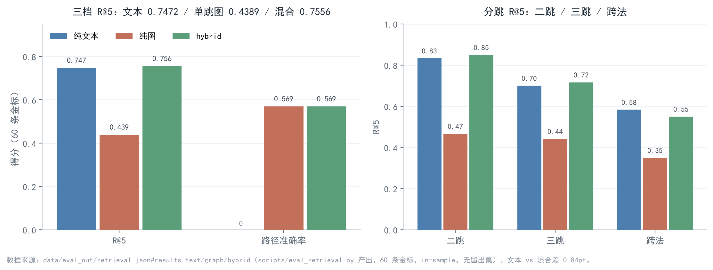
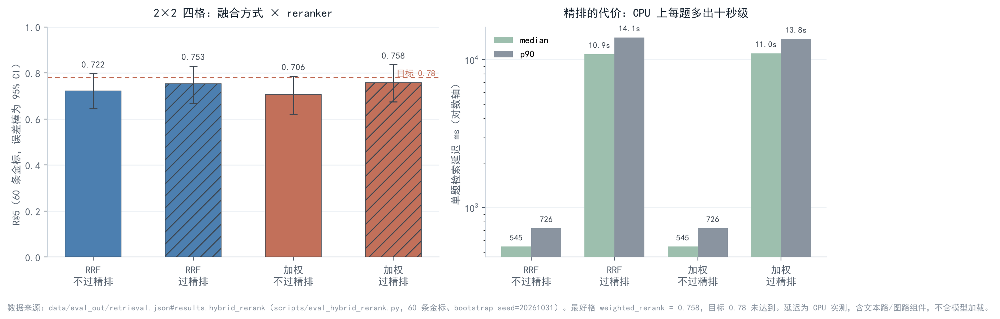

# 口径先于分数：法律知识图谱增强检索的四个「反直觉」结果

> 2026-10-31｜单域法律问答（民法典 / 劳动法 / 劳动合同法，1,465 条）｜检索在 CPU 上复算，量化在一张 8 GB 卡上复算
> 一句话：这篇记录里没有一个「提升了多少」的结论，多数实验的答案是「没变」。能这么写，是因为口径先定好了。

## 0. 为什么「口径」比分数重要

LexWeave 是我独立做的一个法律问答项目：1,465 条法条抽成 Article / Concept / Scenario 三层，落成一张 1799 节点 / 5826 边的图，再和文本检索组成双路召回，最后接引用生成与闸门校验。

写第一版对外材料时，我差点犯一个很常见的错误：把每个指标里最好看的那个数字挑出来，拼成一条上升曲线。后来发现，决定这类工作可信度的并不是 R@5 提高了多少，而是每个数字都能回答三个问题：样本多少条、参数是不是在同一批题上选的、95% 区间有没有跨 0。

我给自己定了三条纪律：

1. **同名指标必须带口径标签。** 同一个 DEFINES 关系，默认图里是 710 条，严口径的可信子集是 559 条（含人工补的 5 条语义边共 564 条）。这两个数不能混着用，也不能取平均。
2. **差异只认配对 bootstrap 的 95% 区间。** 区间跨 0 就写「持平」，不写「略有提升」。
3. **oracle 只能用来定位上限**，不能当成可部署能力写进结论。

下面四个实验都是在这套纪律下做的，所以结论都不太「好看」。

## 1. 实验一：删掉 90 条假边，R@5 没有掉

**背景是别名。** 法律条文里同一个概念有多种叫法（「承运人」与「承运」、「保管人」与「保管」），术语库最后收敛到 811 个别名、57 处冲突。冲突本身不可怕，可怕的是「别名把一条边错挂到另一个概念上」：图上看是连通了，检索时却把一个不相关的条文排进 top-5。

**误配不靠人眼打分。** 我写了一个机械复核器，先把「概念串是否在条文原文里字面出现」这件事拆成可复核的事实，再归成四个桶：`absent`（概念名和别名都不出现）、`derived_only`（只以「X 人 / X 权 / X 者」这类派生形式出现）、`pending_semantic`（字面出现，但机械判据给不出定义式或分句主语位的证据）、`normal`（字面出现且落在定义式或主语位）。归类逻辑就是几行 if-else，没有任何语义推断：

```python
# check_defines_edges.py L152-159
    if not literal:
        bucket = "absent"
    elif not standalone:
        bucket = "derived_only"
    elif any(e["evidence"] for e in evidence):
        bucket = "normal"
    else:
        bucket = "pending_semantic"
```

这套口径下，概念串完全不出现的误配代理从 19.9% 降到 **9.58%（68/710）**；只看 705 条规则边是 **8.94%**。另有 **211 条**字面出现但落在非主语位的边，我只标「待语义判定」——既不计入误配，也不冒充成结论。这一桶是这套方法最诚实的部分：它承认机械判据到此为止。

**然后是重建图。** 90 条失去任何字面支撑的规则边被整条删除（不是降级成弱边），DEFINES 落到 710 条（705 条规则 + 5 条人工补的语义边），图仍是 1799 节点 / 5826 边。重建前后逐条比对 60 条金标的 top-5：**R@5 从 0.4417 到 0.4417，60 条里 recall 变化为 0**。之后把概念层补边吸收进图，R@5 变成 0.4389——4 条题变动（2 升 2 降），小于二项抽样标准误（约 0.064），只能算噪声。

所以这一步的诚实结论是：**删假边没有损伤召回，但也没有提升召回。** 它真正的收益不在分数，而在「每条边现在都能指回条文里的字面证据」。这句话在面试里不好听，但它是我敢把另外三个实验的数字摆出来的前提。



*图 1：文本路 / 单跳图路 / 混合路的 R@5 与分跳结果（60 条金标）。图路的短板在跨法类问题上最明显。*

## 2. 实验二：图路和文本路的差距，调参抹不平

先把当前口径摆齐（全部 60 条金标、in-sample、无留出集；1 条题 ≈ 1.67pp）：

| 档 | R@5 | 说明 |
|---|---|---|
| 纯文本 | **0.7472** | dense + BM25 融合 |
| 单跳图路 | **0.4389** | 概念扩展一跳 |
| 2-hop 剪枝 | **0.6111** | 只走 REQUIRES / SPECIAL_OF |
| PPR | **0.5917** | 个性化 PageRank |
| 混合 | **0.7556** | 文本 + 图加权 |
| 加权 + 精排 | **0.7583** | +1.11pt，95% CI 含 0 |

2-hop 把图路从 0.4389 拉到 0.6111，PPR 到 0.5917，延迟分别是 224.7 ms 和 239.2 ms，都没超过基线 301.5 ms 的两倍。但这不是「图路达标」，更不是「图路优于文本路」：**0.6111 仍然低于文本的 0.7472，而且参数是在同一批 60 条上选的，没有留出集。** 我最多能说「在这 60 条上过了 0.58 这条线」，不能把它写成能力。

关键设计就一条：**遍历只走概念关系边，REFERS_TO 只做末梢投影。** REFERS_TO 有 4,119 条，占全图的七成，让它参与多跳，结果会被高频概念的条文淹没。展开逻辑如下：

```python
# graph_2hop.py L124-152
    def _expand(self, seeds: dict[str, float], keep_inferred: bool) -> tuple[dict[str, float], dict[str, int]]:
        expanded = dict(seeds)
        frontier = dict(seeds)
        stats = {"concept_edges": 0, "requires": 0, "special_of": 0, "reverse": 0, "inferred": 0}
        for _ in range(self.MAX_HOPS):
            nxt: dict[str, float] = {}
            for cid, w in frontier.items():
                for v, rel, conf, inferred in self.concept_out.get(cid, []):
                    if inferred and not keep_inferred:
                        continue
                    weight = self.W_REQUIRES if rel == "REQUIRES" else self.W_SPECIAL_OF
                    nxt[v] = max(nxt.get(v, 0.0), w * weight * conf)
                    stats["concept_edges"] += 1
                    stats["requires" if rel == "REQUIRES" else "special_of"] += 1
                    stats["inferred"] += int(inferred)
                for u, rel, conf, inferred in self.concept_in.get(cid, []):
                    if inferred and not keep_inferred:
                        continue
                    weight = self.W_REQUIRES if rel == "REQUIRES" else self.W_SPECIAL_OF
                    nxt[u] = max(nxt.get(u, 0.0), w * weight * conf * self.W_REVERSE)
                    stats["concept_edges"] += 1
                    stats["requires" if rel == "REQUIRES" else "special_of"] += 1
                    stats["reverse"] += 1
                    stats["inferred"] += int(inferred)
            # 每跳前沿剪枝：只保留权重最高的 MAX_FRONTIER 个概念
            frontier = dict(sorted(nxt.items(), key=lambda kv: -kv[1])[: self.MAX_FRONTIER])
            for cid, w in frontier.items():
                expanded[cid] = max(expanded.get(cid, 0.0), w)
        return expanded, stats
```

这里有个容易被忽略的硬上限：如果连「概念 → 条文」的投影也禁用 REFERS_TO，候选池的结构上限只有 0.3056。那种严格读法下 0.58 不是调参能到的，而是结构上不可达。

**瓶颈到底在哪？** 用 oracle 定位（注意：oracle 不是实测能力）：融合后 25 条候选池里，最优选 5 条的上限是 **0.9194 / 0.9250**，60 条里有 52 / 53 条金标全在池内。实测精排只拿到 0.7528 / 0.7583，也就是「从 25 条里挑 5 条」损失了约 16.7pp。候选够，排序不够。

精排值不值？加精排最好一格是 0.7583，相对文本 **+1.11pt，CI 含 0**；而 CPU 上精排每题多出 **+10.4 s**。它把 80% 的 top-5 位置都重排了一遍，净增益却只有一个点的量级。按我的口径，这叫「止损项」，不叫「增益项」。



*图 2：四格 R@5（误差棒为 95% CI）与单题延迟（对数轴）。虚线是 0.78 目标，四格都没到；精排把延迟抬到十秒级。*

### 2.1 评测样本本身也是口径

检索这一节只有 60 条金标，很容易被「1 条题 = 1.67pp」骗。所以我另外做了 200 条金标（100 / 66 / 34，按跳数分层），两轮独立标注的 Cohen κ 是 **0.9473 / 0.9329**，条文层必要性 **173/200**，与抽取任务 test 集的条文交集为 0。

κ 这个数字我吃过一次亏，值得写出来。金标构建的第二遍是让模型从候选条文里挑必要项，结果缓存命中时，调用方按整数取键，而缓存里存的键是 JSON 序列化后的字符串——于是每条边的标签都被读成 0，g01 直接变成 `[0, 0, 0, 0]`，两轮一致性被硬生生拉低。修复就是一行字典推导：

```python
# build_gold.py L222-227
    key = cache.key("passb", salt, question, listing)
    cached = cache.get(key)
    if cached is not None:
        # 缓存里 labels 的键是 json 序列化后的字符串（"0".."n"），必须转回 int，
        # 否则缓存命中时调用方按 int 取键会全部读成 0（g01 就是这样被写成 [0,0,0,0] 的）。
        return {int(i): int(v) for i, v in cached["labels"].items()}
```

修复后 κ 回到 0.9473 / 0.9329。这件事的教训不是「缓存要小心」，而是：**当一个一致性指标突然变差时，先怀疑读数据的代码，再怀疑标注本身。**

路由同理。级联路由（规则快路 → 语义层 → 低置信才走 LLM）准确率 **0.7731（95% CI [0.7192, 0.8231]）**，只看 200 条金标是 **0.705**，LLM 兜底触发率 **18.85%**，**未达 0.88**。未达不是「没调够」：金标里的 hop_type 与真实跳数有 46/200 不一致，用一个完美的跳数识别器（oracle，非实测）在同样的标签上也只有 0.8731，整体上限低于 0.88。这是标签口径的问题，继续换模型只是在拟合标注习惯。

## 3. 实验三：量化和投机，两个「理论上应该更好」的失败

**量化：q5 淘汰 fp16。** 200 题、四档共用同一份预计算检索上下文、temperature=0 的口径下，q5_K_M 的引用精度 **0.4110**，fp16 是 **0.4119**，配对差 +0.02pt、95% CI 含 0；显存 **1.3 GB**、单题 **2.90 s**，而 fp16 是 3.3 GB / 5.13 s。同精度、2.5 倍显存、1.77 倍延迟，fp16 严格被支配。所以这个项目默认选 q5——不是因为 q5「更准」，而是因为它在精度上没输、在成本上全赢。

**fp8 KV：只买到容量，没买到速度。** KV 容量实测精确 **2.00×**（306,688 → 613,392 token），但同后端下输出吞吐 **−9.6% ~ −12.4%**，TPOT 涨 10.8% ~ 14.1%。更麻烦的是输出不是无损：20 条贪心题逐字一致 **0/20**，而 bf16 自身两次独立启动是 20/20，所以这不是采样噪声。结论：在本机 0.5B、4k 上下文、KV 远没打满的场景里，容量收益一点也用不上，只付了计算代价。想用 fp8 KV，先证明你的瓶颈是 KV 容量。

**投机解码：接受率不低，端到端还是负收益。** 1.5B 目标 + 0.5B draft，draft 接受率 **57.5%**（7,204 / 12,524，平均 4 个 draft token 接受 2.3 个），但端到端只有 **0.88×**，也就是慢 12%。原因很朴素：每一步要 4 次 draft 前向 + 1 次目标前向，被接受的 2.3 个 token 摊不薄 4 次 draft 的开销；再加上 `--enforce-eager` 没有 CUDA Graph，Python 与调度开销全暴露；而且 1.5B 目标本身太便宜，固定开销占比过高。顺带一个口径坑：有 draft 的那遍答案平均短 18%，单题延迟中位数看起来反而快 2%，必须按 tokens/s 和 ms-per-token 归一才有可比性。

## 4. 边界与未做

- 检索全部是 **60 条、in-sample、无留出集**。0.6111 只能说「在这 60 条上过线」，任何「图路更强」的说法都不成立——它低于文本路的 0.7472。
- 混合与精排的增益 **CI 含 0**；oracle 0.9194 / 0.9250 只用于说明「候选够、排序不够」，不是可部署指标。
- 量化与投机都是单机单流、短上下文；换 7B、换长上下文、换并发批处理，结论都可能反过来。fp8 KV 的逐字一致率是**复现性指标，不是质量指标**。

**未做的三件事：**

1. **LLM 重跑 ablation。** 四档消融还是图重建之前的真实 LLM 口径，本阶段没有重跑；用 `--no-llm` 重跑会换掉生成口径，那是换赛道，不是复评。
2. **GPU 精排。** +10.4 s 是 CPU 实测，「值不值 200 ms」里的 200 ms 是假想成本，GPU 上的精排延迟我没有测，所以这个问题我只回答了一半。
3. **>400 条金标。** 60 条里 1 题就是 1.67pp，5pt 级别的差异要在 400 条以上才分得开。现在所有「+1 ~ +3pt」都只能当方向，不能当结论。

写完这四个实验，我最大的感受是：**能把「没变」写成结论，比写出一堆「提升」更难，也更值钱。** 前提只有一个——口径先定好，再去看分数。
